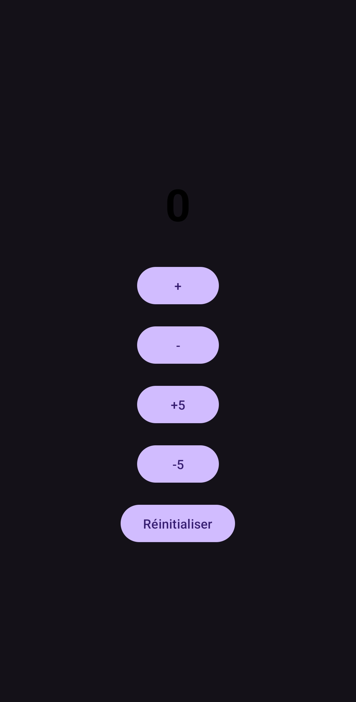
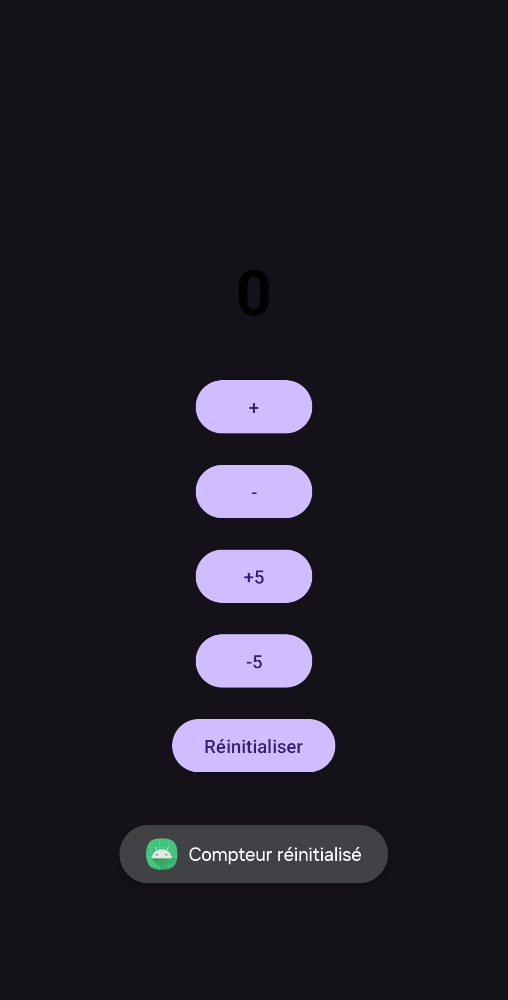
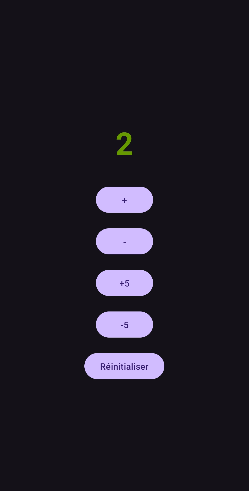

# TP1 – Compteur Android

Projet Android réalisé dans le cadre du cours à l’ISET Djerba.

## Fonctionnalités
- Incrémentation et décrémentation du compteur
- Réinitialisation à zéro
- Interface simple et intuitive

## Technologies
- Kotlin, XML Layout
- Min SDK 24 / Target SDK 37

## Installation
1. Cloner le dépôt
2. Ouvrir avec Android Studio
3. Ajouter vos clés dans `local.properties` (ex: MAPS_API_KEY)
4. Lancer sur un émulateur ou un appareil physique

## Captures d’écran
## Captures d’écran

## Auteur
Triki Mohamed Amine – ISET Djerba / Groupe 2
